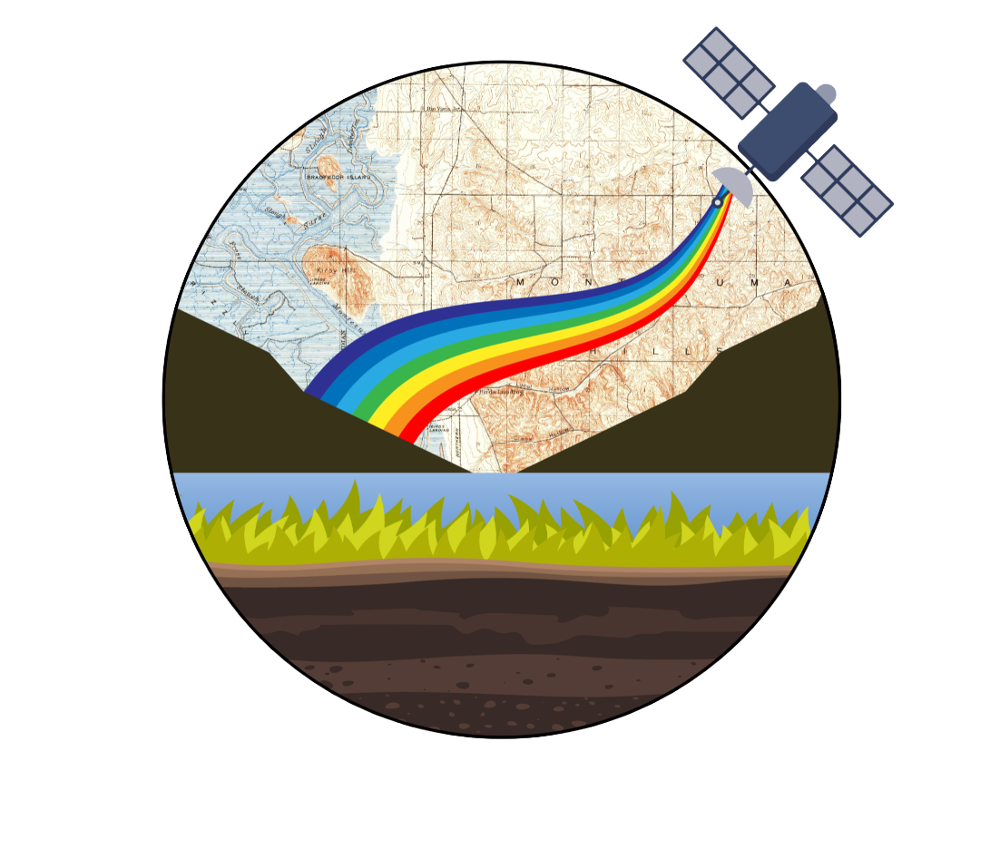

## Telmatology

### (tel·ma·tol·o·gy | ˌtelməˈtäləjē ) *noun*

Definition: a branch of physical geography concerned with the study of wetlands (such as marshes or swamps)

## About: Who am I?

  

I am a researcher / teacher that combines a mix of field, laboratory, remote sensing, and modeling approaches to understand geographic and spatial processes in wetlands (typically from the prospective of plants and soil) for both foundational and applied science endeavors. Much of my previous work has been done in collaboration or consultation with wetland managers to understand a variety of challenges wetlands face. Previous projects have investigated wetland plant salinity response, post-disturbance landcover change, factors for plant establishment success, and innovative uses of field and airborne spectroscopy for wetland ecosystem and geographic science. Truly my work captures the full breadth of my branch of geography, telmatology.

Currently, I am located at California State University, Stanislaus as I establish myself and look for a more permanent home. 

